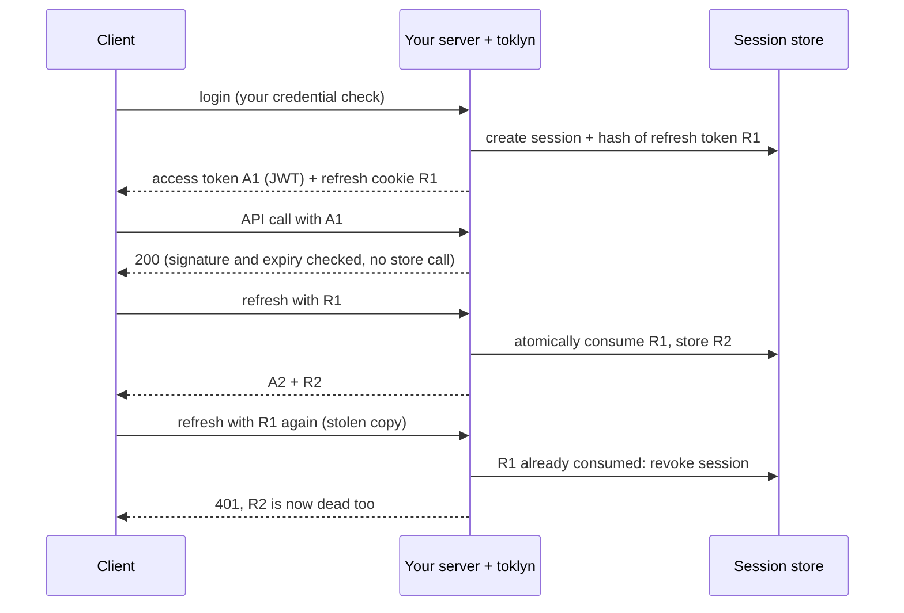

# toklyn

**Access and refresh token sessions for TypeScript, with rotation, reuse detection and pluggable storage.**

[](https://www.npmjs.com/package/toklyn)
[](https://github.com/singhgulshan/toklyn/actions/workflows/ci.yml)
[](LICENSE)
[](https://nodejs.org)
[](https://www.typescriptlang.org)

toklyn issues short-lived JWT access tokens and long-lived opaque refresh tokens, stores sessions server-side, rotates the refresh token on every use and revokes the whole session when a used token comes back. You keep your own login logic (passwords, OAuth, magic links); toklyn takes over from "this user is who they claim to be".

## Contents

- [Features](#features)
- [Packages](#packages)
- [Install](#install)
- [Quick start](#quick-start)
- [How it works](#how-it-works)
- [Configuration](#configuration)
- [Signing keys](#signing-keys)
- [HTTP integration](#http-integration)
- [Frameworks](#frameworks)
- [Storage](#storage)
- [Errors](#errors)
- [Events](#events)
- [Security model](#security-model)
- [Runtime support](#runtime-support)
- [Examples](#examples)
- [Development](#development)
- [License](#license)

## Features

- **Refresh-token rotation with reuse detection.** Every refresh returns a new refresh token. Presenting an old one revokes the session, so a stolen token stops working for both the attacker and the user.
- **Server-side sessions.** List a user's sessions, revoke one, or sign a user out everywhere.
- **Secure defaults.** `HttpOnly`, `Secure`, `__Host-` cookies, `SameSite=Strict`, origin checks on cookie-authenticated writes, `Cache-Control: no-store`, the JWT algorithm pinned by config.
- **Two transports.** Bearer tokens for SPAs and APIs, or HttpOnly access cookies for server-rendered pages.
- **Framework adapters** for Express, NestJS and Next.js, built on one framework-neutral HTTP layer.
- **Pluggable storage.** In-memory for development, Redis/Valkey/Upstash for production, or your own store, checked by a shipped contract test suite.
- **Typed claims.** Your claims type flows through to every verified token; reserved JWT claim names are rejected at compile time and at runtime.
- **Small and portable.** One runtime dependency ([`jose`](https://github.com/panva/jose)), Web Crypto only, ESM and CommonJS builds.

## Packages

| Package                               | Description                                                             | Version                                                                                                      |
| ------------------------------------- | ----------------------------------------------------------------------- | ------------------------------------------------------------------------------------------------------------ |
| [`toklyn`](packages/core)             | Core: sessions, tokens, stores, plus `toklyn/http` and `toklyn/testing` | [](https://www.npmjs.com/package/toklyn)                   |
| [`@toklyn/express`](packages/express) | Express 5 middleware and route handlers                                 | [](https://www.npmjs.com/package/@toklyn/express) |
| [`@toklyn/nest`](packages/nest)       | NestJS module, guard and decorators                                     | [](https://www.npmjs.com/package/@toklyn/nest)       |
| [`@toklyn/next`](packages/next)       | Next.js App Router route handlers, proxy and server-component helpers   | [](https://www.npmjs.com/package/@toklyn/next)       |
| [`@toklyn/redis`](packages/redis)     | Redis, Valkey and Upstash session and revocation stores                 | [](https://www.npmjs.com/package/@toklyn/redis)     |

All packages share one version number and are released together.

## Install

```sh
npm install toklyn
# plus the adapter you need, for example:
npm install @toklyn/express
```

Requires Node.js 22.12 or later.

## Quick start

```ts
import {
  JwtAccessTokenSigner,
  JwtAccessTokenVerifier,
  MemorySessionStore,
  createAuth,
} from 'toklyn';

interface AppClaims {
  role: string;
}

// Generate once with `openssl rand -base64 32` and keep it in your secret manager.
const keyConfig = {
  keys: [
    {
      kid: 'k1',
      algorithm: 'HS256' as const,
      secret: Buffer.from(process.env.ACCESS_TOKEN_SECRET ?? '', 'base64'),
    },
  ],
};

const auth = createAuth<AppClaims>({
  signer: new JwtAccessTokenSigner(keyConfig),
  verifier: new JwtAccessTokenVerifier(keyConfig),
  sessions: new MemorySessionStore(),
  accessTokenTtlSeconds: 5 * 60,
  refreshTokenTtlSeconds: 7 * 24 * 60 * 60,
  sessionMaxAgeSeconds: 30 * 24 * 60 * 60,
});

// 1. After your own credential check:
const tokens = await auth.createSession({
  subject: user.id,
  claims: { role: user.role },
  metadata: { userAgent: 'Firefox on macOS' },
});

// 2. On every request:
const claims = await auth.verifyAccessToken(tokens.accessToken);
claims.sub; // user id
claims.role; // typed as string

// 3. When the access token expires:
const rotated = await auth.refresh({ refreshToken: tokens.refreshToken });

// 4. On logout:
await auth.revokeSession(claims.sid);
```

A secret shorter than 32 bytes throws at startup, so a missing environment variable fails fast instead of signing with a weak key.

In a web app you rarely call `refresh` yourself: the [HTTP layer](#http-integration) and the [framework adapters](#frameworks) handle cookies, refresh and logout routes for you.

## How it works



- **Access tokens** are JWTs with `sub`, `sid` (session id), `jti`, `iat`, `exp`, plus your claims. They never outlive their session.
- **Refresh tokens** are 256-bit random strings. Only their SHA-256 hash is stored.
- **Sessions** have an absolute lifetime (`sessionMaxAgeSeconds`) that rotation never extends. A refresh token expires at `min(now + refreshTokenTtlSeconds, session expiry)`.
- **Rotation** is one atomic store operation: validate, consume, insert the successor, or revoke on reuse. Two concurrent refreshes with the same token can never both succeed outside the grace window.
- **Grace window.** `reuseGraceMs` (default `0`, strict) lets a just-consumed token be used again for a short time, for clients that legitimately send parallel refreshes. Cookie mode requires it.

### Verification modes

| Mode                | Checks                                                                                                     | Store call per request | Revocation takes effect       |
| ------------------- | ---------------------------------------------------------------------------------------------------------- | ---------------------- | ----------------------------- |
| `offline` (default) | Signature, algorithm, issuer, audience, expiry                                                             | No                     | When the access token expires |
| `online`            | All of the above, plus the session exists and is active, plus the `jti` denylist when `revocations` is set | Yes                    | Immediately                   |

`online` fails closed: if the store is unreachable, verification throws `storage_error` (HTTP 503) instead of letting the request through. Keep access tokens short-lived in `offline` mode; 5 to 15 minutes is typical.

## Configuration

`createAuth<TClaims>(config)` returns an [`Auth`](packages/core/src/auth.ts) object.

| Option                   | Type                         | Default      | Description                                                      |
| ------------------------ | ---------------------------- | ------------ | ---------------------------------------------------------------- |
| `signer`                 | `AccessTokenSigner`          | required     | Usually `new JwtAccessTokenSigner(keyConfig)`                    |
| `verifier`               | `AccessTokenVerifier`        | required     | Usually `new JwtAccessTokenVerifier(keyConfig)`                  |
| `sessions`               | `SessionStore`               | required     | See [Storage](#storage)                                          |
| `accessTokenTtlSeconds`  | `number`                     | required     | Access token lifetime                                            |
| `refreshTokenTtlSeconds` | `number`                     | required     | Lifetime of each refresh token (sliding)                         |
| `sessionMaxAgeSeconds`   | `number`                     | required     | Absolute session lifetime from creation                          |
| `verification`           | `'offline' \| 'online'`      | `'offline'`  | See [Verification modes](#verification-modes)                    |
| `revocations`            | `AccessTokenRevocationStore` | none         | Denylist for single access tokens; needed by `revokeAccessToken` |
| `reuseGraceMs`           | `number`                     | `0`          | Grace window for reusing a just-rotated refresh token            |
| `onEvent`                | `(event: AuthEvent) => void` | none         | See [Events](#events)                                            |
| `refreshTokens`          | `RefreshTokenCodec`          | Web Crypto   | Custom refresh-token generation and hashing                      |
| `clock`                  | `Clock`                      | system clock | Inject time in tests                                             |

| Method                                           | Description                                                                                           |
| ------------------------------------------------ | ----------------------------------------------------------------------------------------------------- |
| `createSession({ subject, claims?, metadata? })` | Starts a session and returns a `TokenPair`                                                            |
| `refresh({ refreshToken, claims? })`             | Rotates the refresh token; `claims` replaces the stored claims, for example after a role change       |
| `verifyAccessToken(token)`                       | Returns the typed claims or throws a `ToklynError`                                                    |
| `revokeSession(sessionId)`                       | Revokes one session (idempotent)                                                                      |
| `revokeAllSessions(subject)`                     | Signs a user out everywhere                                                                           |
| `listSessions(subject)`                          | Active sessions, for a "your devices" page                                                            |
| `revokeAccessToken(token)`                       | Denylists one access token until it expires; requires `revocations` and takes effect in `online` mode |

## Signing keys

The algorithm always comes from your config, never from the token header ([RFC 8725 §3.1](https://www.rfc-editor.org/rfc/rfc8725#section-3.1)).

**HMAC** (`HS256`, `HS384`, `HS512`): the secret must be at least as long as the hash output, so 32, 48 or 64 bytes ([RFC 7518 §3.2](https://www.rfc-editor.org/rfc/rfc7518#section-3.2)).

**Asymmetric** (`RS*`, `PS*`, `ES*`, `EdDSA`): pass `CryptoKey` objects. Services that only verify tokens omit `privateKey`.

```ts
import { importPKCS8, importSPKI } from 'jose';

const keyConfig = {
  issuer: 'https://auth.example.com',
  audience: 'https://api.example.com',
  keys: [
    {
      kid: '2026-10',
      algorithm: 'ES256' as const,
      privateKey: await importPKCS8(privateKeyPem, 'ES256'),
      publicKey: await importSPKI(publicKeyPem, 'ES256'),
    },
  ],
};
```

**Rotation.** List several keys, each with a `kid`, and choose the one that signs with `signingKid`. Keep the old key until its last token has expired:

```ts
const keyConfig = {
  signingKid: '2026-11',
  keys: [
    { kid: '2026-11', algorithm: 'HS256' as const, secret: newSecret },
    { kid: '2026-10', algorithm: 'HS256' as const, secret: oldSecret },
  ],
};
```

Give your key a `kid` from the start. A token without a `kid` can only be verified while exactly one key is configured.

| `AccessTokenConfig` option | Description                                          |
| -------------------------- | ---------------------------------------------------- |
| `keys`                     | Keys accepted for verification                       |
| `signingKid`               | Key that signs; required when there are several keys |
| `issuer`                   | Sets and checks `iss`                                |
| `audience`                 | Sets and checks `aud`                                |
| `clockToleranceSeconds`    | Allowed clock skew when checking `exp`; default `0`  |

## HTTP integration

`toklyn/http` turns `Auth` into framework-neutral request handlers. The adapters are thin wrappers around it; use it directly for any other framework.

```ts
import { createToklynHttp } from 'toklyn/http';

const http = createToklynHttp(auth, {
  allowedOrigins: ['https://app.example.com'],
});

// With a Web `Request`:
const result = await http.authenticate({
  method: request.method,
  header: (name) => request.headers.get(name),
});
// result.ok ? result.claims : send result.response (status, headers, JSON body)
```

### Bearer mode

The default, for SPAs and API clients.

- Login and refresh return the access token in the JSON body. The client keeps it **in memory** and sends `Authorization: Bearer <token>`.
- The refresh token is an `HttpOnly` cookie, `__Host-toklyn_refresh`, `SameSite=Strict`, so JavaScript never sees it.
- On page load and on a `401`, the client calls the refresh route once and retries. Send only one refresh at a time; see [`examples/express/public/app.js`](examples/express/public/app.js).

### Cookie mode

`accessToken: 'cookie'`, for server-rendered pages that need the user during rendering.

- Both tokens are `HttpOnly` cookies (`__Host-toklyn_access` and `__Host-toklyn_refresh`), `SameSite=Lax` by default. The response body has no token.
- Methods other than `GET`, `HEAD` and `OPTIONS` need a trusted origin, which protects against CSRF.
- `resolve(request)` refreshes an expired access cookie in middleware and returns the cookies to forward, so the page sees the new token in the same request.
- Requires `reuseGraceMs > 0` on `auth` (10 seconds works well), because a page load can trigger several parallel requests with the same refresh cookie.

### HTTP options

| Option           | Type                   | Default                                           | Description                                                                            |
| ---------------- | ---------------------- | ------------------------------------------------- | -------------------------------------------------------------------------------------- |
| `accessToken`    | `'bearer' \| 'cookie'` | `'bearer'`                                        | Where the access token travels                                                         |
| `cookie`         | `CookieOptions`        | `toklyn_refresh`, `Strict` (`Lax` in cookie mode) | Refresh cookie                                                                         |
| `accessCookie`   | `CookieOptions`        | `toklyn_access`, `Lax`                            | Access cookie, cookie mode only                                                        |
| `allowedOrigins` | `string[]`             | `[]`                                              | Origins trusted for cookie-authenticated writes, for example `https://app.example.com` |
| `clock`          | `Clock`                | system clock                                      | Used for cookie `Max-Age`                                                              |

| `CookieOptions` | Default   | Notes                                                                                                             |
| --------------- | --------- | ----------------------------------------------------------------------------------------------------------------- |
| `name`          | see above | Base name. `__Host-` is prepended when `secure`, `path: '/'` and no `domain`; otherwise `__Secure-` when `secure` |
| `path`          | `'/'`     |                                                                                                                   |
| `domain`        | host-only | Setting it drops the `__Host-` prefix                                                                             |
| `secure`        | `true`    | Set `false` only for local development over plain HTTP                                                            |
| `sameSite`      | see above | `'Strict'`, `'Lax'` or `'None'`; `'None'` requires `secure` and a non-empty `allowedOrigins`                      |

Every option is validated when you call `createToklynHttp`; an invalid value throws `invalid_config`.

**Trusted origin** means the browser sent `Sec-Fetch-Site: same-origin`, or an `Origin` listed in `allowedOrigins`. Requests with neither header are rejected. The refresh and logout routes always require it, so non-browser clients must send an allowed `Origin`.

### Responses

| Handler         | Success                                 | Failure                                                                                                          |
| --------------- | --------------------------------------- | ---------------------------------------------------------------------------------------------------------------- |
| `issue(tokens)` | `200`, cookies, session body            | none                                                                                                             |
| `authenticate`  | claims                                  | `401` (with `WWW-Authenticate: Bearer` in bearer mode), `403` untrusted write in cookie mode, `503` storage down |
| `refresh`       | `200`, new cookies, session body        | `403` untrusted origin, `401` and cookies cleared, `503` with cookies kept                                       |
| `logout`        | `204`, cookies cleared, session revoked | `403` untrusted origin, `503`                                                                                    |

All responses carry `Cache-Control: no-store`. Every authentication failure returns the same `{"error":"unauthorized"}` body, so a client cannot tell an expired token from a forged one.

## Frameworks

### Express

```ts
import { createToklynExpress, getAuth } from '@toklyn/express';

const toklyn = createToklynExpress(auth);

app.post('/api/login', async (req, res) => {
  const user = await checkPassword(req.body);
  if (!user) {
    res.status(401).json({ error: 'unauthorized' });
    return;
  }
  toklyn.sendSession(res, await auth.createSession({ subject: user.id }));
});
app.post('/api/refresh', toklyn.refreshHandler);
app.post('/api/logout', toklyn.logoutHandler);
app.get('/api/me', toklyn.requireAuth, (req, res) =>
  res.json(getAuth<AppClaims>(req)),
);
```

More in the [`@toklyn/express` README](packages/express) and [`examples/express`](examples/express).

### NestJS

```ts
@Module({
  imports: [ToklynModule.forRoot({ auth })],
  providers: [{ provide: APP_GUARD, useClass: ToklynAuthGuard }],
})
export class AppModule {}

@Controller('api')
export class MeController {
  @Get('me')
  me(@ToklynClaims() claims: AccessTokenClaims<AppClaims>) {
    return claims;
  }
}
```

More in the [`@toklyn/nest` README](packages/nest) and [`examples/nest`](examples/nest).

### Next.js

Bearer mode for client-side apps, with route handlers only:

```ts
// app/api/refresh/route.ts
export const POST = toklyn.refresh;

// app/api/me/route.ts
export const GET = toklyn.withAuth((request, { claims }) =>
  Response.json(claims),
);
```

Cookie mode for server components, server actions and the proxy:

```ts
// proxy.ts
export function proxy(request: NextRequest) {
  return toklyn.proxy(request);
}

// app/dashboard/page.tsx
const claims = await toklyn.requireClaims();
```

More in the [`@toklyn/next` README](packages/next), [`examples/next`](examples/next) and [`examples/next-ssr`](examples/next-ssr).

## Storage

| Store                                                    | Package                                                    | Use for                                                             |
| -------------------------------------------------------- | ---------------------------------------------------------- | ------------------------------------------------------------------- |
| `MemorySessionStore`, `MemoryAccessTokenRevocationStore` | `toklyn`                                                   | Development and tests. State is per process and lost on restart     |
| `RedisSessionStore`, `RedisAccessTokenRevocationStore`   | [`@toklyn/redis`](packages/redis)                          | Production: Redis 6.2+, built for Valkey, Upstash and Redis Cluster |
| Your own                                                 | implement [`SessionStore`](packages/core/src/contracts.ts) | Any database with atomic updates                                    |

A custom `SessionStore` must make `rotate` atomic. Check your implementation with the contract suites from `toklyn/testing` (requires [Vitest](https://vitest.dev)):

```ts
import { revocationStoreContract, sessionStoreContract } from 'toklyn/testing';

sessionStoreContract(
  'PostgresSessionStore',
  () => new PostgresSessionStore(pool),
);
revocationStoreContract(
  'PostgresRevocations',
  (clock) => new PostgresRevocations(pool, clock),
);
```

## Errors

Every failure is a `ToklynError` with a stable `code`:

| Code                    | When                                                                   | HTTP layer |
| ----------------------- | ---------------------------------------------------------------------- | ---------- |
| `invalid_config`        | Invalid options at startup, or signing failed                          | thrown     |
| `invalid_input`         | Empty subject, reserved claim name, non-object claims                  | thrown     |
| `invalid_access_token`  | Bad signature, algorithm, issuer, audience or shape                    | `401`      |
| `access_token_expired`  | `exp` has passed                                                       | `401`      |
| `access_token_revoked`  | `jti` is denylisted (`online` mode)                                    | `401`      |
| `invalid_refresh_token` | Unknown or malformed refresh token                                     | `401`      |
| `refresh_token_expired` | Refresh token past its expiry                                          | `401`      |
| `refresh_token_reused`  | A consumed token was presented again; the session is now revoked       | `401`      |
| `session_not_found`     | Session is gone (`online` mode)                                        | `401`      |
| `session_expired`       | Session reached `sessionMaxAgeSeconds`                                 | `401`      |
| `session_revoked`       | Session was revoked                                                    | `401`      |
| `storage_error`         | The store threw or was unreachable; the cause is kept in `error.cause` | `503`      |

```ts
import { ToklynError } from 'toklyn';

try {
  await auth.refresh({ refreshToken });
} catch (error) {
  if (error instanceof ToklynError && error.code === 'refresh_token_reused') {
    // Possible token theft: alert the user.
  }
  throw error;
}
```

## Events

```ts
createAuth({
  // ...
  onEvent(event) {
    if (event.type === 'refresh_reuse_detected') {
      logger.warn(
        { subject: event.subject, sessionId: event.sessionId },
        'refresh token reuse',
      );
    }
  },
});
```

| Event                    | When                                                                     |
| ------------------------ | ------------------------------------------------------------------------ |
| `session_created`        | `createSession` succeeded                                                |
| `token_refreshed`        | `refresh` rotated a token                                                |
| `refresh_reuse_detected` | A consumed refresh token came back; always followed by `session_revoked` |
| `session_revoked`        | A session was revoked by you or by reuse detection                       |

A listener that throws never breaks authentication.

## Security model

What toklyn does:

- Rotates refresh tokens and revokes the session on reuse, as recommended by the OAuth 2.0 Security Best Current Practice ([RFC 9700 §4.14](https://www.rfc-editor.org/rfc/rfc9700#section-4.14)).
- Stores only SHA-256 hashes of refresh tokens, so a database leak does not leak usable tokens.
- Pins the JWT algorithm per key and requires `sub`, `sid`, `jti`, `iat` and `exp` ([RFC 8725](https://www.rfc-editor.org/rfc/rfc8725)).
- Enforces minimum HMAC key sizes ([RFC 7518 §3.2](https://www.rfc-editor.org/rfc/rfc7518#section-3.2)) and copies secrets so later buffer changes cannot alter a live key.
- Sets cookies `HttpOnly`, `Secure` and with the [`__Host-` prefix](https://developer.mozilla.org/en-US/docs/Web/HTTP/Headers/Set-Cookie#cookie_prefixes), and treats duplicate cookies with different values as missing, which blocks cookie tossing from sibling subdomains.
- Checks [Fetch Metadata](https://web.dev/articles/fetch-metadata) and `Origin` on cookie-authenticated writes ([OWASP CSRF Prevention Cheat Sheet](https://cheatsheetseries.owasp.org/cheatsheets/Cross-Site_Request_Forgery_Prevention_Cheat_Sheet.html)).
- Returns identical `401` responses for every authentication failure and `Cache-Control: no-store` on every response.
- Bounds the length of presented tokens, limiting the work an attacker can force.

What stays your responsibility:

- Verifying credentials (password hashing, rate limiting, MFA) before `createSession`.
- Keeping secrets and private keys out of source control.
- Serving over HTTPS. `secure: false` is for local development only.
- Accepting that in `offline` mode a revoked session's access token remains valid until it expires. Use short access-token lifetimes, or `online` mode where immediate revocation matters.
- Protecting against XSS. Tokens in `HttpOnly` cookies cannot be read by scripts, but an XSS can still make requests as the user.

See also the [OWASP Session Management Cheat Sheet](https://cheatsheetseries.owasp.org/cheatsheets/Session_Management_Cheat_Sheet.html).

## Runtime support

- Node.js 22.12 or later, ESM and CommonJS.
- Only Web Crypto and standard Web APIs, no Node built-ins: `toklyn` and `@toklyn/next` are tested on Node and on the [Edge Runtime](https://github.com/vercel/edge-runtime).
- TypeScript types included, built and tested with `strict` and `noUncheckedIndexedAccess`.
- Framework versions: Express 5, NestJS 9 or later (Express and Fastify platforms), Next.js 15 or later for `@toklyn/next/server`.

## Examples

Runnable apps in [`examples/`](examples), each with a demo login (`demo` / `demo`):

| Example                                  | Shows                                                                                     |
| ---------------------------------------- | ----------------------------------------------------------------------------------------- |
| [`examples/express`](examples/express)   | Express API and a vanilla JS client with in-memory access token and single-flight refresh |
| [`examples/nest`](examples/nest)         | NestJS with a global guard and `@ToklynPublic()` routes                                   |
| [`examples/next`](examples/next)         | Next.js route handlers in bearer mode, with a sessions page                               |
| [`examples/next-ssr`](examples/next-ssr) | Next.js cookie mode: proxy, server components, server actions                             |

```sh
pnpm install
pnpm build
pnpm --filter @toklyn/example-express start   # or example-nest start, example-next dev, example-next-ssr dev
```

The Express example runs TypeScript directly and needs Node.js 22.18 or later.

## Development

```sh
pnpm install
pnpm build
pnpm test              # Redis tests need a server at REDIS_URL (default redis://localhost:6379)
pnpm test:edge
pnpm lint
pnpm typecheck
pnpm format:check
pnpm check:exports     # are-the-types-wrong on every package
```

Releases use [Changesets](https://github.com/changesets/changesets):

```sh
pnpm changeset          # describe a change (patch, minor or major)
pnpm version-packages   # bump versions and write changelogs
pnpm release            # build and publish to npm
```

## License

[MIT](LICENSE)
